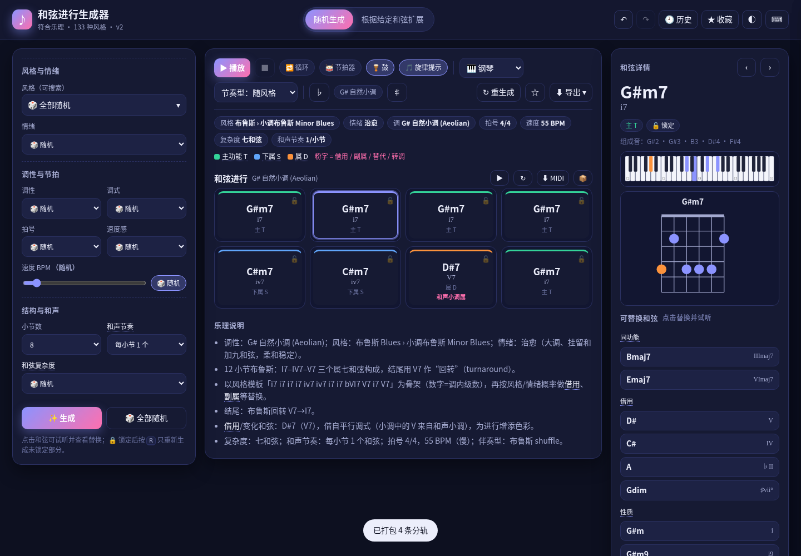

# 🎹 和弦进行生成器（Chord Progression Generator）

一个**符合乐理**的随机和弦进行生成器。整个程序是一个单独的 `index.html` 文件，CSS 和 JS 全部内联，没有任何外部依赖，用浏览器打开就能用，界面是中文的。

## 功能

### 两种模式
- **随机生成**：根据风格、情绪、调式等参数生成一段和弦进行。
- **根据给定和弦扩展**：输入一个或多个种子和弦（如 `Am F C G` 或 `Dm7`），程序自动推断调性和调式（会列出候选，可点选或手动改），再按当前设置生成完整歌曲结构：
  前奏 Intro / 主歌 Verse / 导歌 Pre-chorus / 副歌 Chorus / 桥段 Bridge / 间奏 / 尾奏 Outro
  - 主歌循环种子和弦，副歌对种子做轮转、功能代理替换（I↔vi、IV↔ii）或扩展；
  - 导歌和桥段从下属功能开始，以半终止停在 V；副歌和尾奏以正格、变格或调式终止收尾；
  - 可选让**最后一次副歌上移全音转调**，上一段末尾用新调的 V7 作过渡；
  - 歌曲长度分短 / 标准 / 长三档。

### 参数（每项都能设为 🎲 随机，另有「全部随机」按钮）
| 参数 | 选项 |
|---|---|
| 拍号 | 2/4、3/4、4/4、5/4、6/8、7/8、9/8、12/8 |
| 速度 | BPM 40–220 滑块，加「快 / 中 / 慢」速度感 |
| 调性 | 12 个调 |
| 调式 | 大调、自然 / 和声 / 旋律小调、多利亚、弗里几亚、利底亚、混合利底亚、洛克里亚 |
| 风格 | **17 个大类、133 种子风格**：流行（K-pop、J-pop、华语流行、City Pop、Synthpop…）、摇滚、爵士（Bebop、Bossa Nova、调式爵士、Smooth…）、布鲁斯、R&B/灵魂乐/Neo-soul、放克、嘻哈/Lo-fi/Trap、EDM（House、Trance、Future Bass、Dubstep…）、古典（巴洛克、古典主义、浪漫主义、印象派…）、民谣/乡村、拉丁、金属、游戏/影视配乐、国风/五声、福音、雷鬼、氛围 |
| 情绪 | 欢快、悲伤、史诗、浪漫、紧张、治愈、梦幻、黑暗、怀旧、神秘、激昂、平静、忧郁、慵懒、中性 |
| 小节数 | 4 / 8 / 12 / 16 / 24 / 32 |
| 和弦复杂度 | 三和弦 / 七和弦 / 九·十一·十三 / 变化和弦（altered） |
| 和声节奏 | 每 2 小节 1 个，或每小节 1 / 2 / 4 个和弦 |
| 伴奏节奏型 | 随风格，或手动选：柱式、脉冲、分解、铺底、摇摆走路贝斯、skank、shuffle、扫弦、放克、拉丁、波萨诺瓦、Boom-bap、阿尔贝蒂低音、圆舞曲 |

### 生成算法
- 每种风格都带着自己的乐理数据：常用调式的权重、罗马数字模板（流行 I–V–vi–IV、爵士 ii–V–I、12 小节布鲁斯、安达卢西亚进行 i–♭VII–♭VI–V、王道进行 IV–V–iii–vi、卡农进行、适合五声的国风进行…）、典型复杂度、速度范围、常用拍号、伴奏型，以及借用和弦、副属和弦、三全音替代、转位、挂留和弦各自出现的概率。
- 情绪会改变调式的偏好、借用和弦的概率、张力（延伸音）和速度。
- 和弦来源有两种：风格模板，或主(T)→下属(S)→属(D) 的加权马尔可夫链（会强调调式的特征和弦）。之后按概率加入借用、副属、三全音替代，结尾保证有合适的终止式（正格、变格、调式终止，布鲁斯用回转）。
- 声部进行：上方声部选与前一个和弦移动最小的转位，低音在“平滑”和“尽量用原位”之间权衡，需要时写成斜线和弦（如 `G7/B`）。
- 和弦名按字母拼写（在 G 大调里写 F#，不写 Gb）。

### 输出
- 和弦符号（如 `Cmaj7`、`F#m7b5`、`G7/B`）、罗马数字（`V7/ii`、`subV7/I`、`♭VII`…）、功能标签（T/S/D 用颜色区分，借用 / 副属 / 替代 / 转调用粉色标注）。
- 按拍号分小节显示，附简短的乐理说明。
- Web Audio 播放：按 BPM 和风格节奏型演奏，可开节拍器，支持播放 / 停止 / 循环，播放时高亮当前和弦，点单个和弦可试听。
- 可**导出 MIDI**（含速度和拍号信息，和弦与贝斯分在两个通道）和**复制为文本**。

### v2 新增：编辑、可视化与分享
- **锁定和弦并重新生成其余部分**：点和弦右上角的 🔓，或选中后按 <kbd>L</kbd> 锁定；按 <kbd>R</kbd> 重新生成未锁定的和弦。每个段落都可以单独重新生成、单独播放、单独导出 MIDI。
- **可替换和弦**：点击任意和弦，右侧会列出符合乐理的替换（同功能代理、三度代理、副属 V/x、三全音替代、借用和弦、和弦性质变化），每项都附说明，点一下即可替换并试听。
- **撤销 / 重做 / 历史**：<kbd>Ctrl+Z</kbd> 撤销，<kbd>Ctrl+Shift+Z</kbd> 重做，最多保留 60 步历史。
- **收藏与分享**：收藏保存在浏览器本地存储（localStorage）里；分享链接把整段进行编码进 URL 的 `#p=` 部分，打开链接即可还原同一段进行。
- **移调**：用 ♭ / ♯ 按钮或 <kbd>[</kbd> <kbd>]</kbd> 键，和弦的级数和功能都不变。
- **和弦可视化**：显示钢琴键盘上的实际音位（低音单独着色），并自动计算一个可弹奏的吉他指法图。
- **音色与鼓组**：和弦音色可选钢琴、电钢琴、合成铺底、吉他扫弦；鼓组节奏按风格自动选择，有四拍底鼓、摇滚、Boom-bap、摇摆、One-drop、波萨、放克、Shuffle 等；还可以打开一条基于和弦音的“旋律提示”。
- **分轨导出**：和弦、低音、旋律、鼓各自导出一个 .mid（鼓在第 10 通道，带速度、拍号、轨名和和弦标记），也可以「全部分轨打包」成一个 .zip；全曲和单段都支持。
- **导出**：全曲或单段 MIDI（format 1 多轨）（和弦、贝斯、旋律、鼓分别放在不同通道），PNG 和弦谱，文本文件，复制文本，分享链接。
- **界面**：深色 / 浅色主题；风格选择器可搜索、按大类分组；乐理术语悬停可看解释；动画过渡；完整的快捷键（按 <kbd>?</kbd> 查看）；适配手机。

## 使用
直接用浏览器打开 `index.html` 即可。快捷键：空格键播放 / 停止，Enter 生成。

## 开发
源码在 `src/` 目录：`engine.js` 是纯乐理引擎，Node 和浏览器通用；`ui.js` 是界面逻辑；另有 `style.css` 和 `template.html`。`build.js` 把它们合并成单文件 `index.html`。

```bash
npm run build   # 生成 index.html
npm test        # 构建，再跑随机组合测试
node test/browser.test.cjs   # 无头 Chrome 端到端检查（需要 playwright 和 Chrome）
```



测试（`test/engine.test.js`）会跑 3000 组随机生成和 1500 组种子扩展，共约 200 万条断言。检查的内容包括：
- 和弦符号能被重新解析，且根音和性质与生成结果一致；
- 每个声部音都属于该和弦，低音也是和弦音；
- 小节时值正好填满拍号；
- 一定以主和弦结尾；
- 转调确实上移全音，且前面有新调的 V7 过渡；
- 导出的 MIDI 结构合法；
- 调性推断正确，例如 `C G Am F` 判为 C 大调，`Am F C G` 判为 A 小调，`G F C G` 判为 G 混合利底亚。

## 许可
MIT
